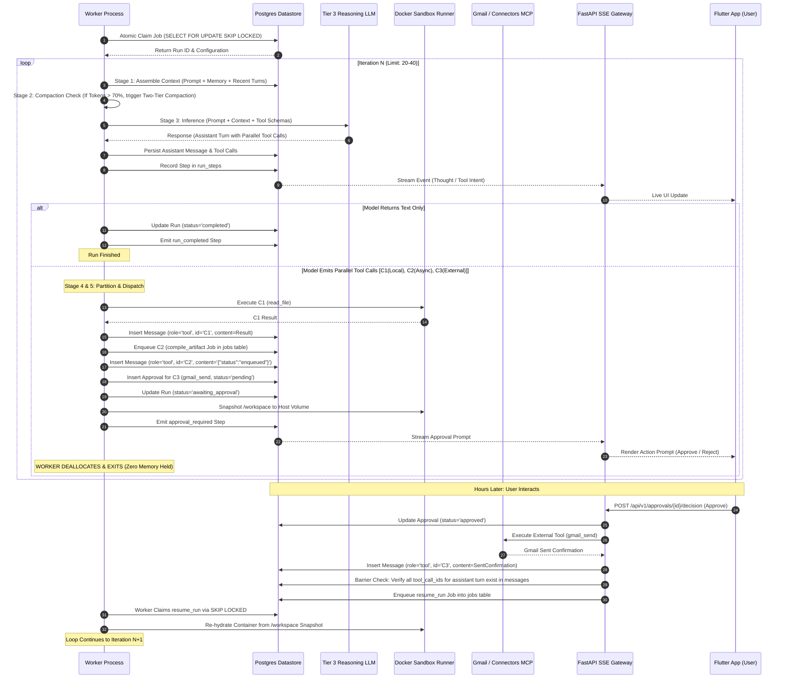
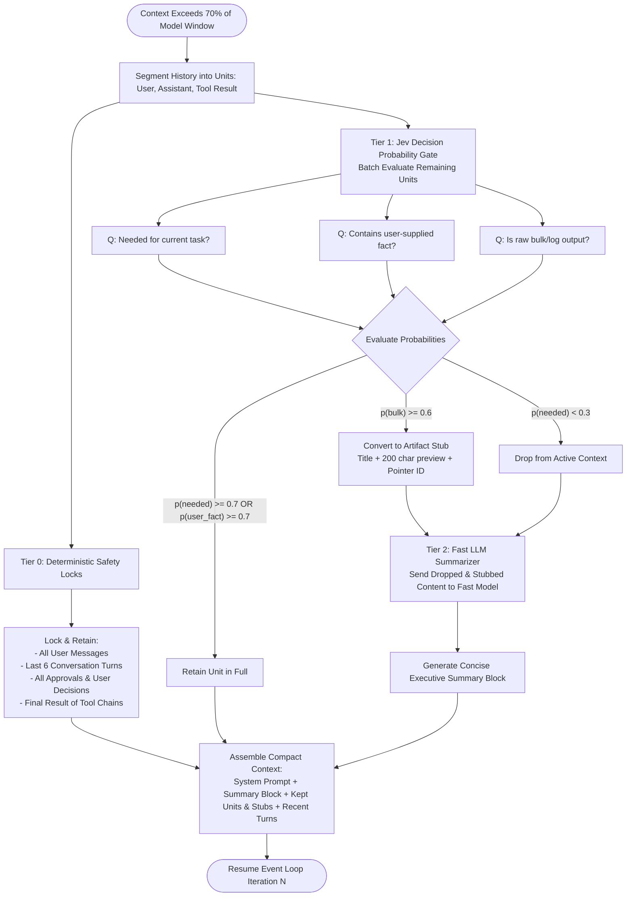

# Vigil (`virgil-agent`)

> **Open-Source, Self-Hostable Proactive AI Assistant & Sandboxed Execution Harness**  
> *Draft 0.1 Technical Specification & Production Implementation Blueprint*

---

## Table of Contents

1. [Executive Summary & System Philosophy](#1-executive-summary--system-philosophy)
2. [Viability & Why Traditional Agent Architectures Fail](#2-viability--why-traditional-agent-architectures-fail)
3. [Module-Driven Architecture & Coding Standards](#3-module-driven-architecture--coding-standards)
4. [Complete Monorepo Directory Layout](#4-complete-monorepo-directory-layout)
5. [Centralized Database Schemas & Table Definitions](#5-centralized-database-schemas--table-definitions)
6. [Deep-Dive: Core Subsystem 1 — The Stateless 6-Stage Event Loop & Multi-Tool Barrier Synchronizer](#6-deep-dive-core-subsystem-1--the-stateless-6-stage-event-loop--multi-tool-barrier-synchronizer)
7. [Deep-Dive: Core Subsystem 2 — Long-Term Memory & Exponential Time-Decay Retrieval (`pgvector`)](#7-deep-dive-core-subsystem-2--long-term-memory--exponential-time-decay-retrieval-pgvector)
8. [Deep-Dive: Core Subsystem 3 — Postgres-Backed Job Queue (`SKIP LOCKED`) & Worker Engine](#8-deep-dive-core-subsystem-3--postgres-backed-job-queue-skip-locked--worker-engine)
9. [Deep-Dive: Core Subsystem 4 — Two-Tier Context Compaction (Jev Filter + Fast LLM Summarizer)](#9-deep-dive-core-subsystem-4--two-tier-context-compaction-jev-filter--fast-llm-summarizer)
10. [Deep-Dive: Core Subsystem 5 — Two-Stage Proactive Triage Pipeline](#10-deep-dive-core-subsystem-5--two-stage-proactive-triage-pipeline)
11. [Deep-Dive: Core Subsystem 6 — Docker Sandbox Runner & Volume Lifecycle](#11-deep-dive-core-subsystem-6--docker-sandbox-runner--volume-lifecycle)
12. [Deep-Dive: Core Subsystem 7 — Connectors Engine & Standalone Gmail MCP Connector](#12-deep-dive-core-subsystem-7--connectors-engine--standalone-gmail-mcp-connector)
13. [Exhaustive Phase-by-Phase Implementation Roadmap](#13-exhaustive-phase-by-phase-implementation-roadmap)

---

## 1. Executive Summary & System Philosophy

Vigil acts as an autonomous personal chief of staff. It continuously monitors incoming communication streams, tracked tasks, deadlines, and project milestones. Rather than passively waiting for user prompts, Vigil triages events using a cost-efficient decision model (Jev), surfaces actionable notification cards to a companion Flutter mobile app, and executes complex multi-step coding, document compilation, file transformation, and communication runs inside an isolated Linux sandbox under an approval-first security model.

### Key Architectural Tenets

1. **Approval-First Execution**: The agent can inspect files, write code, run compilers, and generate artifacts freely inside its isolated Docker sandbox. However, **any external side-effect** (sending an email, creating external drafts, publishing webhooks, modifying third-party accounts) strictly pauses execution and requires user approval via the mobile card UI.
2. **Stateless Process Deallocation**: When an execution pauses for human approval or an asynchronous background task, the worker process **releases all memory and terminates**. Run state is serialized entirely within PostgreSQL. Approvals hours or days later resume execution seamlessly, surviving server restarts and container evictions.
3. **Single Datastore Simplicity**: By running relational state, the atomic worker queue (`FOR UPDATE SKIP LOCKED`), and vector memory (`pgvector`) within PostgreSQL 16+, Vigil eliminates the operational complexity of Redis, Celery, or external vector databases for self-hosters.
4. **Decoupled Connectors via Model Context Protocol (MCP)**: External services (Gmail, Google Calendar, Slack, GitHub) are not hardcoded into core application logic. They are implemented as standalone MCP connectors that expose polling capabilities and tools governed by standard approval policies.

---

## 2. Viability & Why Traditional Agent Architectures Fail

### The In-Memory Trap
Most popular agent frameworks (LangChain, AutoGen, CrewAI, naive Pydantic AI loops) maintain execution state in the runtime memory of an async Python thread or generator:

```python
# NAIVE AGENT PATTERN (FAILS IN PRODUCTION)
async def run_loop():
    while not done:
        response = await model.call(history, tools)
        for tool_call in response.tool_calls:
            if tool_call.requires_approval:
                user_ok = await wait_for_user_approval(tool_call) # BLOCKS IN-MEMORY!
```

This pattern fails in production environments for four critical reasons:
1. **Thread/Memory Exhaustion**: If a user takes 6 hours to respond to an approval notification, a worker thread or process remains locked in memory. At scale or on self-hosted VPS nodes, system resources are quickly exhausted.
2. **Server Restart & Eviction Vulnerability**: If the server restarts, containers roll out, or a cold start occurs, all active, paused, or queued runs are dropped and lost.
3. **Parallel Tool Call ID Desynchronization**: Modern LLMs (OpenAI GPT-4o, Anthropic Claude 3.5, Gemini 1.5) frequently emit *multiple parallel tool calls* in a single turn. For example:
   $$\text{Turn } N \rightarrow [C_1: \text{read\_file}, \ C_2: \text{compile\_artifact}, \ C_3: \text{gmail\_send}]$$
   The model API requires that every single tool call ID emitted in Turn $N$ must receive a corresponding `role="tool"` message before Turn $N+1$ can be called. If $C_1$ is auto-approved, $C_2$ is asynchronous, and $C_3$ requires user approval, a naive loop pauses without generating the tool result for $C_1$ or $C_2$. Resuming later produces API protocol violations because IDs are missing or out of order.
4. **Docker Volume Drift**: If an in-progress run modifies files in `/workspace` before pausing, and the sandbox container is reaped due to an idle timeout, resuming hours later in a fresh container results in lost files.

### The Virgil Solution
Virgil eliminates these failure modes through:
- **Stateless DB-backed transitions**: Runs transition between database enum states (`QUEUED`, `RUNNING`, `AWAITING_APPROVAL`, `AWAITING_BACKGROUND_JOB`, `STALE_THREAD_PAUSED`, `COMPLETED`, `FAILED`).
- **A Multi-Tool Barrier Synchronizer**: Partitions parallel tool calls into immediate execution, background queuing, and gated approvals, persisting all partial results and guaranteeing that every tool call ID is satisfied before resuming model inference.
- **Decoupled Workspace Snapshots**: `/workspace` is synced to host storage on pause and re-hydrated into a clean container on resume.

---

## 3. Module-Driven Architecture & Coding Standards

Every backend domain follows Nas's strict **Module-Driven FastAPI Architecture**:

```text
src/modules/<resource>/
├── repository.py      # Holds ONLY typing.Protocol abstractions and DTOs. Zero SQL queries, zero HTTP calls.
├── service.py         # Implements ALL domain logic, database operations, and external client calls.
├── data.py            # Pydantic v2 request/response schemas (DTOs).
├── dependencies.py    # FastAPI DI providers wiring service instances with sessions and settings.
└── router.py          # build_<resource>_router(settings: Settings) -> APIRouter factory.
```

### Architectural Invariants

1. **Repositories are Pure Abstractions**:
   `src/modules/<module>/repository.py` contains exclusively `@runtime_checkable` `typing.Protocol` declarations. No database queries, no ORM session usage, no network calls. It defines the contract of what the module needs.
2. **Services Own All Mechanism and Execution**:
   `src/modules/<module>/service.py` receives the database session (`AsyncSession`), configuration (`Settings`), and integration protocols via constructor dependency injection. It implements the methods declared by the repository protocol via **duck typing**.
3. **Router Factory Pattern**:
   Routers are never exposed as bare, module-level globals (`router = APIRouter(...)`). Every module must expose:
   ```python
   def build_<resource>_router(settings: Settings) -> APIRouter:
       router = APIRouter(prefix="/<resource>", tags=["<Resource>"])
       # Declare route handlers
       return router
   ```
4. **Centralized Schemas vs. Module DTOs**:
   - SQLAlchemy 2.0 ORM models (`Mapped`, `mapped_column`) reside strictly under `src/schemas/`.
   - Module `data.py` files contain only Pydantic v2 validation schemas and wire DTOs.
5. **Central Dependency Aggregation**:
   `src/dependencies.py` is the parent hub importing and re-exporting all module providers and integration dependencies.
6. **Uniform Error Contract**:
   All errors inherit from `AppException` (`src.config.exceptions.AppException`) and return a predictable JSON payload containing correlation tracking:
   ```json
   {
     "code": "RESOURCE_NOT_FOUND",
     "message": "The requested card was not found",
     "request_id": "c678d3cc-6998-4027-8b57-7540a1659011",
     "details": null
   }
   ```

---

## 4. Complete Monorepo Directory Layout

```text
virgil-agent/
├── backend/
│   ├── pyproject.toml                   # Managed strictly via uv
│   ├── uv.lock
│   ├── alembic.ini                      # Alembic database migration config
│   ├── migrations/                      # Alembic migrations (Postgres + pgvector)
│   │   ├── env.py
│   │   └── versions/
│   │       └── 0001_initial_vigil_schema.py
│   ├── src/
│   │   ├── __init__.py
│   │   ├── main.py                      # FastAPI app factory (create_app) & lifespan
│   │   ├── worker.py                    # Background worker & scheduler process entrypoint
│   │   ├── dependencies.py              # Central parent DI aggregator
│   │   │
│   │   ├── config/                      # Core configuration, errors, router root
│   │   │   ├── __init__.py
│   │   │   ├── settings.py              # Pydantic Settings (env vars, tiered models, DB, sandbox)
│   │   │   ├── exceptions.py            # AppException hierarchy + uniform error handlers
│   │   │   ├── logging.py               # Structured JSON/console logging + request_id contextvar
│   │   │   ├── security.py              # Cryptographic hashing & AES-GCM credential encryption
│   │   │   └── router.py                # create_api_router(settings) root router factory
│   │   │
│   │   ├── middlewares/                 # ASGI Middlewares
│   │   │   ├── __init__.py
│   │   │   ├── request_id.py            # X-Request-ID correlation tracking
│   │   │   ├── timing.py                # X-Process-Time performance headers
│   │   │   └── idempotency.py           # Idempotency-Key validation for mutating endpoints
│   │   │
│   │   ├── schemas/                     # ONLY Centralized SQLAlchemy 2.0 ORM Models
│   │   │   ├── __init__.py
│   │   │   ├── base.py                  # DeclarativeBase, UUIDPrimaryKeyMixin, TimestampMixin
│   │   │   ├── identity.py              # users, devices
│   │   │   ├── connectors.py            # connector_accounts, sync_state, items
│   │   │   ├── triage.py                # triage_results, cards
│   │   │   ├── runtime.py               # agent_configs, runs, messages, approvals, artifacts, run_steps
│   │   │   ├── memory.py                # memory_chunks (pgvector Vector column), skills
│   │   │   └── system.py                # jobs (SKIP LOCKED queue), audit_log
│   │   │
│   │   ├── integrations/                # Infrastructure & Foundation Model Clients
│   │   │   ├── __init__.py
│   │   │   ├── repositories.py          # Abstract Protocols (typing.Protocol) for all integrations
│   │   │   ├── database/
│   │   │   │   ├── __init__.py
│   │   │   │   └── database.py          # AsyncEngine, AsyncSession factory, pgvector setup
│   │   │   ├── jev/
│   │   │   │   ├── __init__.py
│   │   │   │   └── jev.py               # TypeSafe AI Jev Decision API client
│   │   │   ├── llm/
│   │   │   │   ├── __init__.py
│   │   │   │   └── llm.py               # OpenAI-compatible multi-provider adapter (Tier 2 Fast + Tier 3 Reasoning)
│   │   │   ├── sandbox/
│   │   │   │   ├── __init__.py
│   │   │   │   └── sandbox.py           # Docker socket proxy runner & /workspace snapshots
│   │   │   ├── mcp/
│   │   │   │   ├── __init__.py
│   │   │   │   └── mcp.py               # MCP client host (stdio & SSE transports)
│   │   │   └── notifications/
│   │   │       ├── __init__.py
│   │   │       └── ntfy.py              # ntfy.sh / UnifiedPush / FCM push dispatcher
│   │   │
│   │   └── modules/                     # Domain Feature Modules
│   │       ├── __init__.py
│   │       ├── health/                  # Liveness and readiness probes
│   │       ├── auth/                    # Pairing codes, QR provisioning, device bearer auth
│   │       ├── cards/                   # Action cards feed, lifecycle, feedback loop
│   │       ├── triage/                  # Two-stage triage pipeline (Jev gate -> Fast LLM metadata)
│   │       ├── runs/                    # Stateless Agent Event Loop, step execution, SSE streaming
│   │       ├── approvals/               # Pending approvals queue, decision handling
│   │       ├── chat/                    # Direct interactive agent sessions
│   │       ├── artifacts/               # Workspace artifact delivery & storage
│   │       ├── memory/                  # Chunking, embeddings & exponential time-decay retrieval
│   │       ├── compaction/              # Two-tier context compaction (Jev filter + LLM summarizer)
│   │       ├── skills/                  # Skill manifests, registry, loading into sandbox
│   │       ├── connectors/              # MCP connector manager, sync orchestration
│   │       ├── settings/                # Runtime system configuration & limits
│   │       └── jobs/                    # Postgres SKIP LOCKED worker & cron scheduler
│   │
│   └── tests/
│       ├── conftest.py
│       ├── unit/
│       ├── integration/
│       └── replay/
├── connectors/                          # Standalone MCP Connectors (Decoupled from Core)
│   └── gmail/                           # Gmail MCP server (polling, history sync, search, draft, send)
├── mobile/                              # Deferred: Flutter companion mobile application
│   └── README.md
├── web/                                 # Deferred: Portfolio hybrid replay demo web application
│   └── README.md
├── skills/                              # Bundled example skills (client-inquiry, weekly-report, etc.)
├── deploy/                              # Docker Compose, environment templates, systemd units
└── docs/                                # Architectural specifications and reference guides
```

---

## 5. Centralized Database Schemas & Table Definitions

All 16 tables carry UUID primary keys, user identification, and timezone-aware UTC timestamps.

### 5.1 Base Mixins (`src/schemas/base.py`)
```python
import uuid
from datetime import datetime
from sqlalchemy import DateTime, Uuid, func
from sqlalchemy.dialects.postgresql import JSONB
from sqlalchemy.orm import DeclarativeBase, Mapped, declared_attr, mapped_column

class Base(DeclarativeBase):
    @declared_attr.directive
    def __tablename__(cls) -> str:
        return f"{cls.__name__.lower()}s"

class UUIDPrimaryKeyMixin:
    id: Mapped[uuid.UUID] = mapped_column(Uuid(as_uuid=True), primary_key=True, default=uuid.uuid4, index=True)

class CreatedAtMixin:
    created_at: Mapped[datetime] = mapped_column(DateTime(timezone=True), server_default=func.now(), nullable=False)

class TimestampMixin(CreatedAtMixin):
    updated_at: Mapped[datetime] = mapped_column(DateTime(timezone=True), server_default=func.now(), onupdate=func.now(), nullable=False)

JSONBType = JSONB()
```

### 5.2 Identity Tables (`src/schemas/identity.py`)
- **`users`**:
  - `id: UUID` (PK)
  - `display_name: str`
  - `settings: dict` (JSONB: spending caps, polling intervals, approval defaults)
  - `created_at`, `updated_at`
- **`devices`**:
  - `id: UUID` (PK)
  - `user_id: UUID` (FK -> users.id)
  - `name: str` (e.g. "Nas's Pixel 8")
  - `token_hash: str` (SHA-256 hash of device bearer token, indexed)
  - `push_token: str | None` (ntfy topic or FCM device token)
  - `last_seen_at: datetime`
  - `revoked_at: datetime | None`

### 5.3 Connectors Tables (`src/schemas/connectors.py`)
- **`connector_accounts`**:
  - `id: UUID` (PK)
  - `user_id: UUID` (FK -> users.id)
  - `connector_id: str` (e.g., "gmail", "gcalendar")
  - `account_label: str` (e.g., "work@example.com")
  - `encrypted_credentials: str` (AES-256-GCM encrypted OAuth token / refresh token)
  - `scopes: list[str]` (JSONB)
  - `status: str` ("active", "needs_reauth", "error", "disabled")
  - `enabled_tools: list[str]` (JSONB)
- **`sync_state`**:
  - `connector_account_id: UUID` (PK, FK -> connector_accounts.id)
  - `cursor: str` (e.g. Gmail `history_id`)
  - `last_success_at: datetime`
  - `last_error: str | None`
- **`items`**:
  - `id: UUID` (PK)
  - `connector_account_id: UUID` (FK -> connector_accounts.id)
  - `external_id: str` (Unique message ID from provider)
  - `thread_id: str` (Indexed for conversation bundling)
  - `sender: str`
  - `recipients: list[str]` (JSONB)
  - `subject: str`
  - `body_text: str`
  - `received_at: datetime` (Indexed)
  - `labels: list[str]` (JSONB)
  - `raw_reference: str | None` (Pointer to cold storage artifact if bulky)
  - *Constraints*: `UNIQUE(connector_account_id, external_id)`

### 5.4 Triage & Action Cards (`src/schemas/triage.py`)
- **`triage_results`**:
  - `id: UUID` (PK)
  - `item_id: UUID` (FK -> items.id, unique)
  - `answers: dict` (JSONB)
  - `probabilities: dict` (JSONB: calibrated Jev probabilities for `action_required`, `has_deadline`, etc.)
  - `decision: str` ("card_created", "discarded", "review_required")
  - `model_version: str`
  - `created_at: datetime`
- **`cards`**:
  - `id: UUID` (PK)
  - `user_id: UUID` (FK -> users.id, indexed)
  - `item_id: UUID | None` (FK -> items.id)
  - `thread_id: str | None` (Indexed)
  - `type: str` ("inquiry", "billing", "deadline", "subscription", "meeting", "security", "general")
  - `urgency: str` ("low", "medium", "high", "critical")
  - `title: str`
  - `summary: str | None`
  - `due_at: datetime | None` (Indexed)
  - `status: str` ("new", "seen", "in_progress", "awaiting_approval", "done", "dismissed", "expired")
  - `actions: list[dict]` (JSONB: action labels, configs, templates)
  - `feedback: str | None` ("useful", "not_useful", "dismissed")
  - *Indexes*: `(user_id, status, urgency)`, `(thread_id, type)`

### 5.5 Runtime Execution & Steps (`src/schemas/runtime.py`)
- **`agent_configs`**:
  - `id: UUID` (PK)
  - `name: str` (Unique, e.g. "card-reply-drafter")
  - `system_prompt: str`
  - `model: str`
  - `tools: list[str]` (JSONB)
  - `skills: list[str]` (JSONB)
  - `memory_scopes: list[str]` (JSONB: ["global", "card"])
  - `approval_policy: dict` (JSONB: `{"read": "auto", "local": "auto", "external": "ask"}`)
  - `limits: dict` (JSONB: `{"max_steps": 40, "max_cost_usd": 0.50, "timeout_seconds": 900}`)
- **`runs`**:
  - `id: UUID` (PK)
  - `config_id: UUID` (FK -> agent_configs.id)
  - `card_id: UUID | None` (FK -> cards.id)
  - `parent_run_id: UUID | None` (FK -> runs.id, self-referential for sub-agents)
  - `depth: int` (Default 0)
  - `status: str` ("queued", "running", "awaiting_approval", "awaiting_background_job", "stale_thread_paused", "completed", "failed")
  - `started_at: datetime`
  - `ended_at: datetime | None`
  - `token_usage: dict` (JSONB: prompt, completion, total)
  - `cost_usd: float`
- **`messages`**:
  - `id: UUID` (PK)
  - `run_id: UUID` (FK -> runs.id, indexed)
  - `session_id: UUID | None` (Indexed, for chat sessions)
  - `role: str` ("user", "assistant", "system", "tool")
  - `content: str | None`
  - `tool_calls: list[dict] | None` (JSONB: tool call definitions emitted by assistant)
  - `tool_call_id: str | None` (Indexed, linking tool results to assistant calls)
  - `tool_name: str | None`
  - `tool_arguments: dict | None` (JSONB)
  - `tool_result_reference: str | None` (Artifact pointer if truncated)
  - `created_at: datetime` (Indexed)
- **`approvals`**:
  - `id: UUID` (PK)
  - `run_id: UUID` (FK -> runs.id, indexed)
  - `tool_call_id: str` (Unique per run)
  - `tool_name: str`
  - `arguments: dict` (JSONB)
  - `status: str` ("pending", "approved", "rejected", "stale")
  - `decided_at: datetime | None`
  - `decision_note: str | None`
- **`artifacts`**:
  - `id: UUID` (PK)
  - `run_id: UUID` (FK -> runs.id)
  - `kind: str` ("document", "diff", "log", "export")
  - `path: str` (Storage path or host volume location)
  - `size_bytes: int`
  - `preview: str | None` (First 200 characters)
  - `created_at: datetime`
- **`run_steps`**:
  - `id: UUID` (PK)
  - `run_id: UUID` (FK -> runs.id, indexed)
  - `step_number: int` (Sequential counter per run)
  - `event_type: str` ("thought", "tool_call", "tool_result", "approval_required", "run_completed", "run_failed")
  - `payload: dict` (JSONB)
  - `created_at: datetime`
  - *Indexes*: `(run_id, step_number ASC)` for SSE resume

### 5.6 Memory & Skills (`src/schemas/memory.py`)
- **`memory_chunks`**:
  - `id: UUID` (PK)
  - `user_id: UUID` (FK -> users.id, indexed)
  - `scope: str` ("global", "card", "agent", indexed)
  - `content: str` (Text representation of the conversational window)
  - `summary: str | None`
  - `source_message_ids: list[UUID]` (JSONB)
  - `embedding: Vector(1536)` (pgvector type)
  - `embedding_model: str`
  - `excluded: bool` (Default False)
  - `created_at: datetime` (Indexed)
  - *Index*: HNSW index on `embedding` (`vector_cosine_ops`, $m=16, \text{ef\_construction}=64$)
- **`skills`**:
  - `id: UUID` (PK)
  - `name: str` (Unique)
  - `description: str`
  - `version: int`
  - `source: str` ("builtin", "git", "upload")
  - `commit: str | None`
  - `enabled: bool`
  - `storage_path: str`

### 5.7 System & Queue (`src/schemas/system.py`)
- **`jobs`**:
  - `id: UUID` (PK)
  - `type: str` ("poll_connector", "triage_item", "execute_run", "resume_run", "index_memory", "cleanup_sandbox")
  - `payload: dict` (JSONB)
  - `run_at: datetime` (Indexed)
  - `attempts: int`
  - `max_attempts: int`
  - `status: str` ("pending", "locked", "completed", "failed", indexed)
  - `locked_by: str | None`
  - `locked_at: datetime | None`
  - `last_error: str | None`
  - *Index*: `(status, run_at ASC)`
- **`audit_log`**:
  - `id: UUID` (PK)
  - `actor: str` ("user", "system", "worker")
  - `action: str` ("approval_decision", "connector_connect", "settings_change")
  - `subject: str`
  - `details: dict` (JSONB)
  - `created_at: datetime`

---

## 6. Deep-Dive: Core Subsystem 1 — The Stateless 6-Stage Event Loop & Multi-Tool Barrier Synchronizer

### Detailed Loop Execution Lifecycle



### The Barrier Synchronizer Invariant
The Barrier Synchronizer enforces the OpenAI tool calling contract without in-memory state:
$$\forall c \in \text{AssistantMessage.tool\_calls}: \ \exists m \in \text{Messages} \text{ such that } m.\text{role} = \text{"tool"} \land m.\text{tool\_call\_id} = c.\text{id}$$

1. If an external tool is approved: The executor runs the tool and writes the resulting output to `messages` with `tool_call_id=c.id`.
2. If an external tool is rejected: The executor generates a structured tool error payload:
   ```json
   {
     "error": "USER_REJECTED",
     "message": "The user rejected this proposed action.",
     "decision_note": "User opted not to send this email."
   }
   ```
   and writes it to `messages` with `tool_call_id=c.id`.
3. The model receives a complete history where every ID is satisfied, allowing it to adapt its reasoning cleanly.

---

## 7. Deep-Dive: Core Subsystem 2 — Long-Term Memory & Exponential Time-Decay Retrieval (`pgvector`)

### 7.1 Chunking & Extraction Write Path (Batched & Fully Asynchronous)

To maintain sub-second response times, **memory indexing NEVER runs synchronously on the user request path**. Embedding models introduce noticeable latency (200ms–1500ms) and API overhead; running an embedding call on every single turn would degrade chat performance and waste API tokens.

Instead, memory is written and embedded through an asynchronous, batched background pipeline:

1. **Strictly Excluded: Zero Embedding of Tool Calls**:
   - **Tool calls and raw tool outputs are NEVER embedded into memory.**
   - Tool arguments, shell logs, JSON schemas, file diffs, and raw tool responses pollute the semantic vector space with low-signal syntax.
   - All tool calls, arguments, and outputs stay preserved in the `messages` table and `artifacts` store for inspection, replay, and compaction.
   - **Only human user messages and assistant natural-language messages** are processed for long-term memory chunking.

2. **Batched Indexing Triggers (5–10 Messages)**:
   - Indexing is batched rather than per-message.
   - An asynchronous `index_memory` background job is registered in the Postgres `jobs` table when:
     a) **Message Threshold**: A session accumulates **5 to 10 un-indexed conversational messages**.
     b) **Run Completion**: A multi-step agent run finishes (`status="completed"`).
     c) **Session Idle Timeout**: A chat conversation has been idle for $> 15$ minutes with at least 2 un-indexed messages.
   - This ensures the user's interactive response is never delayed while embeddings are generated and persisted.

3. **Window Segmentation & Formatting**:
   - The worker claims the `index_memory` job and loads un-indexed user and assistant turns.
   - Messages are segmented into overlapping sliding windows of 4–6 conversational turns (2–3 user-assistant exchanges) with an overlap of 1 exchange.
   - The chunk text is cleanly formatted with actor roles:
     ```text
     [User]: Nas
     [Topic]: Q3 Financial Report
     Please draft the executive summary focusing on cloud spending reduction.
     [Assistant]:
     I have generated the summary highlighting the 14% drop in AWS costs...
     ```

4. **Embedding Generation & Vector Storage**:
   - The batch of text chunks is embedded via the configured embedding client (e.g. OpenAI `text-embedding-3-small`, 1536 dimensions).
   - Chunks are inserted into `memory_chunks` with `user_id`, `scope` (`global`, `card`, `agent`), source message UUID references, and the pgvector embedding vector.
   - The indexed messages are marked with an `indexed_at` timestamp to prevent duplicate chunking.

### 7.2 The Exponential Time-Decay Scoring Formula
Standard cosine similarity fails for assistants because an email discussion from 9 months ago about "travel plans" will outscore a casual remark from yesterday unless time is factored in. Conversely, hard time cutoffs lose critical facts.

Virgil applies an exponential half-life decay function with a non-zero floor and a semantic override gate:

$$\text{similarity} = 1 - (\vec{e}_{\text{chunk}} \Leftrightarrow \vec{q})$$

$$\text{age\_days} = \frac{\text{now}() - \text{created\_at}}{86400}$$

$$\text{decay} = 0.5^{\left(\frac{\text{age\_days}}{\text{half\_life\_days}}\right)} \quad (\text{Default: } \text{half\_life\_days} = 30.0)$$

$$\text{recency\_multiplier} = \text{floor} + (1.0 - \text{floor}) \times \text{decay} \quad (\text{Default: } \text{floor} = 0.35)$$

$$\text{final\_score} = \begin{cases} 
\text{similarity} & \text{if } \text{similarity} \ge \text{override\_threshold } (0.65) \\
\text{similarity} \times \text{recency\_multiplier} & \text{otherwise}
\end{cases}$$

### Mathematical Properties:
- **Halving Property**: Every 30 days, the recency bonus drops by 50%.
- **Non-Zero Floor ($0.35$)**: Even an item from 2 years ago retains at least 35% of its semantic weight. Important past events never disappear completely.
- **High-Confidence Override ($\ge 0.65$)**: If the user asks a specific question ("What was the registration key for Server X?") and an old chunk matches with $\ge 0.65$ cosine similarity, the time penalty is completely bypassed ($\text{multiplier} = 1.0$).
- **Calibration**: 0.85 was the first draft value. Measured on `bge-small-en-v1.5`, correct answers score 0.679 to 0.801 and the best wrong answers score 0.561 to 0.615. A threshold of 0.85 never fires. The shipped value is 0.65. Set the value per model, because each model has its own score range.

### 7.3 Retrieval Path: Exact Scan or Tenant Graph

The candidate query takes one of two paths. The path depends on the number of rows that the user holds in `memory_chunks`. `MEMORY_RETRIEVAL_EXACT_SCAN_MAX_ROWS` sets the crossover.

| Tenant rows | Path name | What answers the query |
| --- | --- | --- |
| At or below the crossover | `exact` | The tenant btree index reduces the heap. The database sorts the tenant rows by cosine distance. The top 50 rows are exact. |
| Above the crossover, with a tenant graph | `hnsw` | The graph of that tenant walks by cosine distance. The partial index holds the rows of one tenant, so the walk spends no budget on other tenants. |
| Above the crossover, without a tenant graph | `exact` | The query falls back to the exact scan. It is correct and slower. |

The exact scan is the default path at low row counts. The vector index is not the default path there. The benchmark gives the cause. With 100,000 rows over 100 users, one tenant is 1 percent of the heap. At `ef_search` 200, the global graph reaches recall@50 of 0.56. The exact scan reaches 0.99998 on the same rows and the same queries.

`hnsw.iterative_scan` does not repair the global graph. The scan mode turns 2 returned rows into 50 rows. The recall stays at 0.56. One global graph holds all tenants, so a walk spends its budget on rows that the filter rejects. The setting cannot make the graph meet the floor on a filtered query.

The measured crossover is 20,000 tenant rows. At 5,000 and 10,000 rows the exact scan is faster, and at 20,000 and 50,000 rows the tenant graph is faster. Section 3.5 of `docs/BENCHMARKS.md` gives the table and the host load.

A tenant graph is a partial HNSW index for one tenant. It is built with `m = 32` and `ef_construction = 200`. On 50,000 rows it reaches recall@50 of 0.9796 at `ef_search` 1000. The global graph reaches 0.8483 on the same rows at the same width. The measured width of a tenant graph is 1000, which is the maximum that pgvector accepts.

A tenant above the crossover gets the graph after the maintenance step builds it. `create_tenant_graph_index` builds the index and retires the global graph, because the global graph stays a valid plan for the tenant query and it then misses the floor. The build blocks writes for its duration, so run it at maintenance time. Until the graph exists, the query uses the exact scan and stays correct.

The query keeps its inputs and its response fields. It also reports the path name, `exact` or `hnsw`, for each query.

### 7.4 Executable SQL Query

The path sets the session before the query runs. The exact path runs these statements first:

```sql
SET LOCAL enable_indexscan = off;
SET LOCAL enable_indexonlyscan = off;
SET LOCAL enable_sort = on;
```

The graph path runs these statements first:

```sql
SET LOCAL hnsw.ef_search = 1000;
-- This setting turns 2 returned rows into 50. It does not raise the recall.
SET LOCAL hnsw.iterative_scan = 'relaxed_order';
SET LOCAL enable_indexscan = on;
SET LOCAL enable_indexonlyscan = on;
SET LOCAL enable_sort = off;
```

The width and the scan mode come from `settings.py`. 1000 is the measured width of a tenant graph. The scan mode changes the row count and not the recall, as Section 7.3 states. The refused sort keeps the btree and a sort from answering the query instead of the tenant graph.

A tenant graph is built by this maintenance statement:

```sql
CREATE INDEX ix_memory_chunks_hnsw_<tenant hex> ON memory_chunks
USING hnsw (embedding vector_cosine_ops)
WITH (m = 32, ef_construction = 200)
WHERE user_id = '<tenant uuid>';

DROP INDEX IF EXISTS ix_memory_chunks_embedding_hnsw;
```

The second statement retires the global graph. After it runs, each tenant query has one usable graph.

The candidate query is the same on both paths. The statements above decide which access method answers it. On the exact path the order is exact. On the graph path the order comes from the graph walk.

```sql
WITH vector_candidates AS (
    SELECT 
        id,
        content,
        summary,
        created_at,
        scope,
        1 - (embedding <=> :query_embedding) AS similarity,
        EXTRACT(EPOCH FROM (NOW() - created_at)) / 86400.0 AS age_days
    FROM memory_chunks
    WHERE user_id = :user_id
      AND scope = ANY(:scopes)
      AND excluded = FALSE
    ORDER BY embedding <=> :query_embedding ASC
    LIMIT :candidate_k -- e.g. 50
)
SELECT 
    id,
    content,
    similarity,
    age_days,
    CASE 
        WHEN similarity >= :override_threshold THEN similarity
        ELSE similarity * (:floor + (1.0 - :floor) * POW(0.5, age_days / :half_life_days))
    END AS final_score
FROM vector_candidates
ORDER BY final_score DESC
LIMIT :top_n; -- e.g. 8
```

---

## 8. Deep-Dive: Core Subsystem 3 — Postgres-Backed Job Queue (`SKIP LOCKED`) & Worker Engine

### 8.1 Zero-Contention Job Claiming
Virgil runs multiple concurrent workers against a single Postgres instance using row-level locking:

```sql
WITH claimable AS (
    SELECT id FROM jobs
    WHERE status = 'pending' 
      AND run_at <= NOW()
    ORDER BY run_at ASC
    FOR UPDATE SKIP LOCKED
    LIMIT 1
)
UPDATE jobs
SET status = 'locked',
    locked_by = :worker_id,
    locked_at = NOW(),
    attempts = attempts + 1
FROM claimable
WHERE jobs.id = claimable.id
RETURNING jobs.*;
```

### 8.2 Crash Resilience & Worker Heartbeats
- **Heartbeat & Reaper**: The worker process runs a lightweight asyncio background loop every 60 seconds executing:
  ```sql
  UPDATE jobs
  SET status = 'pending', locked_by = NULL, locked_at = NULL
  WHERE status = 'locked' 
    AND locked_at < NOW() - INTERVAL '5 minutes';
  ```
  If a worker container crashes or is abruptly killed, abandoned jobs are safely recovered.
- **Exponential Retry with Jitter**:
  When a job raises an unhandled exception:
  $$\text{delay\_seconds} = \min(3600, \ 2^{\text{attempts}} \times 5) \pm \text{jitter}$$
  ```sql
  UPDATE jobs
  SET status = CASE WHEN attempts >= max_attempts THEN 'failed' ELSE 'pending' END,
      run_at = NOW() + (:delay * INTERVAL '1 second'),
      last_error = :error_traceback,
      locked_by = NULL,
      locked_at = NULL
  WHERE id = :job_id;
  ```

---

## 9. Deep-Dive: Core Subsystem 4 — Two-Tier Context Compaction (Jev Filter + Fast LLM Summarizer)

Long-running agent workflows generate massive token bloat (terminal outputs, lint errors, intermediate drafts). Passing this raw text to expensive reasoning models wastes money and degrades prompt attention.



### Artifact Stubbing Format
Bulk data is replaced with a standard plain-text descriptor:
```text
[Truncated Artifact #e4b2a1: tool=bash, command="pytest tests/", size=45KB, exit_code=0]
Preview: ========================= 42 passed in 2.14s =========================
Full log stored in artifacts. Use deliver_file or read_file if detailed inspection is required.
```

---

## 10. Deep-Dive: Core Subsystem 5 — Two-Stage Proactive Triage Pipeline

To achieve near-zero running cost during high-volume background polling, Virgil splits triage into a two-stage filter:

```mermaid
flowchart LR
    Poll[Ingested Message] --> Dedupe[Deduplicate via Unique Index]
    Dedupe --> S1[Stage 1: Jev Decision Classifier\nZero Generative Cost]
    
    S1 --> Gate{p(action_required)}
    Gate -- "< 0.3 AND bulk" --> Discard[Archive / Discard\nZero Token Spend]
    Gate -- "0.3 <= p < 0.8" --> Review[Low-Priority Card:\n'May need a look']
    Gate -- ">= 0.8" --> S2[Stage 2: Fast LLM Extractor\nLightweight gpt-4o-mini / Haiku]
    
    S2 --> Extract[Extract:\n- due_at ISO timestamp\n- Clean 1-sentence title\n- Executive summary\n- Action button presets]
    Extract --> SaveCard[Upsert Action Card in DB]
    SaveCard --> Push[Dispatch Push via ntfy/SSE]
```

### Stage 1: Batched Jev Request Format
```json
{
  "model": "jev-classifier-v1",
  "state": {
    "from": "billing@cloudprovider.com",
    "subject": "Invoice #8921 Overdue - Service Suspension in 48 Hours",
    "body": "Your payment failed. Please update payment method before Nov 2 to avoid cancellation.",
    "received_at": "2026-10-31T14:00:00Z",
    "user_replied_before": false,
    "sender_known": true
  },
  "questions": {
    "action_required": "yes or no probability",
    "urgency": "one of: none, low, medium, high, critical",
    "category": "one of: inquiry, billing, deadline, subscription, meeting, security, newsletter, notification, personal, other",
    "has_deadline": "yes or no probability",
    "is_bulk": "yes or no probability",
    "is_security_sensitive": "yes or no probability"
  }
}
```

---

## 11. Deep-Dive: Core Subsystem 6 — Docker Sandbox Runner & Volume Lifecycle

1. **Security Isolation**:
   - Runs as unprivileged UID `1000`.
   - Read-only root filesystem (`--read-only`), writable `/tmp` (tmpfs) and `/workspace`.
   - All Linux capabilities dropped (`--cap-drop=ALL`).
   - Default seccomp profile applied.
   - Network disabled by default (`--network=none`). Configurable domain allowlist via HTTP proxy sidecar.
2. **Docker Socket Protection**:
   The worker never mounts `/var/run/docker.sock` directly. It communicates through a restricted socket proxy (`tecnativa/docker-socket-proxy`) allowing only `POST /containers/create`, `POST /containers/{id}/start`, `POST /containers/{id}/stop`, `POST /containers/{id}/wait`.
3. **Workspace Snapshot on Pause**:
   When a run transitions to `awaiting_approval`:
   - The container tar-archives `/workspace` to a host volume directory: `/var/vigil/workspaces/{run_id}.tar.gz`.
   - The container is stopped to free CPU and memory.
   - Upon resumption, a clean container starts and extracts the archive back to `/workspace`.

---

## 12. Deep-Dive: Core Subsystem 7 — Connectors Engine & Standalone Gmail MCP Connector

To keep the core backend lean, external services are encapsulated into **Model Context Protocol (MCP)** servers:

```text
connectors/gmail/
├── pyproject.toml
├── src/
│   ├── main.py              # Stdio and SSE MCP server entrypoint
│   ├── auth.py              # Google OAuth2 client, token refresh & PKCE
│   ├── sync.py              # Gmail API historyId cursor sync + 7-day fallback bounded sync
│   └── tools.py             # MCP Tool declarations:
│                            # - gmail_search(query, max_results)
│                            # - gmail_read(message_id)
│                            # - gmail_create_draft(to, subject, body_html)
│                            # - gmail_send(to, subject, body_html)
```

### Backend MCP Client Adapter (`src/integrations/mcp/mcp.py`)
- Discovers tools dynamically via `mcp.list_tools()`.
- Maps tools to approval policies:
  - `gmail_search`, `gmail_read` $\rightarrow$ Level `read` (Auto-approved).
  - `gmail_create_draft`, `gmail_send` $\rightarrow$ Level `external` (Gated approval required).
- Communicates with `connectors/gmail/` over stdio inside a dedicated container or via HTTP/SSE.

---

## 13. Exhaustive Phase-by-Phase Implementation Roadmap


### Phase 1: Foundations & Architecture Scaffold
- **Objective**: Establish the monorepo, environment configuration, dependency injection hierarchy, database connectivity, and base module skeletons.
- **Detailed Tasks**:
  1. Initialize `backend/pyproject.toml` with `uv` (`fastapi`, `uvicorn`, `pydantic-settings`, `sqlalchemy[asyncio]`, `asyncpg`, `pgvector`, `alembic`, `httpx`, `structlog`, `cryptography`, `pytest`, `pytest-asyncio`).
  2. Implement `src/config/`:
     - `settings.py`: Pydantic settings loading database URLs, model keys, ports, secrets.
     - `exceptions.py`: `AppException` hierarchy (`NotFoundError`, `UnauthorizedError`, `ForbiddenError`, `ConflictError`, `ValidationError`).
     - `logging.py`: Structured JSON logging with `request_id` context propagation.
     - `security.py`: Token hashing (`hash_token`) and credential encryption (`encrypt_secret`, `decrypt_secret`).
     - `router.py`: `create_api_router(settings)` calling each module's router builder.
  3. Implement `src/middlewares/`:
     - `request_id.py`: Generates or passes through `X-Request-ID`.
     - `timing.py`: Records latency in `X-Process-Time`.
     - `idempotency.py`: Validates `Idempotency-Key` headers on POST endpoints.
  4. Scaffold all modules with `repository.py` (Protocols only), `service.py`, `router.py` (factory pattern), `dependencies.py`, and `data.py`.
  5. Implement working `health` probe (`GET /api/v1/health`) and `auth` pairing module (`POST /api/v1/auth/pair`) with first-boot ASCII QR / pairing code generation in server logs.
  6. Create `deploy/docker-compose.yml` (`postgres` with `pgvector/pgvector:pg16`, `api`, `worker`).
- **Exit Criteria**: `uv run pytest` passes 100%; server boots and pairing endpoint generates device token.

### Phase 2: Centralized Database Schemas, Migrations & Postgres Job Queue
- **Objective**: Deploy the full relational and vector database schema via Alembic and build the atomic `SKIP LOCKED` job queue.
- **Detailed Tasks**:
  1. Author centralized SQLAlchemy 2.0 models across `src/schemas/`:
     - `identity.py`, `connectors.py`, `triage.py`, `runtime.py`, `memory.py`, `system.py`.
  2. Create Alembic migration:
     - Enable extension `vector`.
     - Create all 16 tables, foreign keys, unique constraints, and indexes (including HNSW vector index).
  3. Implement `src/modules/jobs/`:
     - `service.py`: `enqueue_job`, `claim_next_job` using `SELECT ... FOR UPDATE SKIP LOCKED`, `complete_job`, `fail_job`.
     - `reaper`: Periodic recovery of stale locked jobs ($> 5$ minutes).
     - Worker loop in `src/worker.py`.
- **Exit Criteria**: Migrations apply cleanly; concurrent worker processes claim and complete jobs with zero deadlocks or duplicate executions.

### Phase 3: Connectors Engine, Gmail MCP Connector & Action Cards
- **Objective**: Build the standalone Gmail MCP server, connect it to the backend connectors engine, run two-stage Jev triage, and populate the mobile card feed.
- **Detailed Tasks**:
  1. Build `connectors/gmail/`:
     - OAuth2 flow with Google APIs, token refresh, and encryption.
     - Polling engine using Gmail `historyId` delta sync + 7-day bounded fallback.
     - Tool declarations (`gmail_search`, `gmail_read`, `gmail_create_draft`, `gmail_send`).
  2. Implement `src/integrations/mcp/mcp.py` & `src/modules/connectors/`:
     - Connector registry, account management, sync state persistence.
  3. Implement `src/integrations/jev/jev.py` & `src/modules/triage/`:
     - Stage 1 Jev decision gate calling TypeSafe AI API.
     - Stage 2 Fast LLM extractor generating clean titles, ISO `due_at` timestamps, summaries, and action button templates.
  4. Implement `src/modules/cards/`:
     - Card feed endpoints (`GET /cards`), card detail (`GET /cards/{id}`), feedback endpoint (`POST /cards/{id}/feedback`).
     - Thread de-duplication: new incoming messages update existing cards.
  5. Implement `src/integrations/notifications/ntfy.py`:
     - Dispatch push alerts to mobile devices for high-urgency cards.
- **Exit Criteria**: Polled emails trigger triage, generate cards in DB, and fire notifications with zero missed or duplicate messages.

### Phase 4: Docker Sandbox Runner, Core Tool Harness & Stateless Agent Runtime
- **Objective**: Build the isolated sandbox runner, core tools, and the 6-stage agent event loop with multi-tool barrier synchronization.
- **Detailed Tasks**:
  1. Implement `src/integrations/sandbox/sandbox.py`:
     - Docker container creation via socket proxy.
     - Execution of shell commands and file tools with timeout and output caps.
     - Tar-snapshot and re-hydration of `/workspace` volumes.
  2. Implement Core Tools:
     - `read`, `write`, `edit`, `bash`, `deliver_file`, `ask_user`, `manage_tasks`, `generate_document`.
  3. Implement `src/modules/runs/`:
     - 6-stage loop execution state machine.
     - Partitioning of parallel tool calls (immediate execution vs async jobs vs gated approvals).
     - Multi-tool Barrier Synchronizer.
     - Resumable SSE streaming endpoint (`GET /runs/{id}/events`).
  4. Implement `src/modules/approvals/`:
     - Approval queue (`GET /approvals`), decision endpoint (`POST /approvals/{id}/decision`).
- **Exit Criteria**: Agent runs execute tools in the sandbox, pause without holding worker memory on external tools, and resume cleanly upon user approval.

### Phase 5: Weighted `pgvector` Memory & Two-Tier Context Compaction
- **Objective**: Implement long-term conversation indexing, exponential time-decay retrieval, and Jev-powered context compaction.
- **Detailed Tasks**:
  1. Implement `src/modules/memory/`:
     - Background chunking of completed runs and idle chat sessions.
     - Embedding generation and storage in `memory_chunks`.
     - Two-stage time-decay retrieval query ($K=50$ candidates, half-life 30 days, floor 0.35, override 0.65). The path is exact below the measured crossover and the graph above it.
     - Memory search and deletion endpoints (`GET /memory/search`, `DELETE /memory/chunks/{id}`).
  2. Implement `src/modules/compaction/`:
     - Context size monitor ($> 70\%$ limit).
     - Tier 0 deterministic safety lock.
     - Tier 1 Jev decision batch scoring.
     - Artifact stub replacement.
     - Tier 2 Fast LLM running summary generation.
- **Exit Criteria**: Retrieval tests verify that both recent facts and old high-similarity facts rank in top-8; compaction cuts prompt tokens while maintaining task completion accuracy.

### Phase 6: Skills System, External MCP Servers & Sub-Agent Readiness
- **Objective**: Enable custom user skills, third-party MCP server attachment, and sub-agent execution isolation.
- **Detailed Tasks**:
  1. Implement `src/modules/skills/`:
     - YAML-frontmatter parser for Markdown skill definitions.
     - Git repository skill installer with commit SHA pinning.
     - `skill_load` tool copying skill scripts into the sandbox workspace.
  2. Expand `src/modules/connectors/`:
     - Allow user registration of external stdio and SSE MCP servers.
     - Dynamically wrap discovered tools into the runtime approval policy.
  3. Implement Sub-Agent Readiness:
     - Verify `parent_run_id` and `depth` constraints.
     - Implement child workspace scoping and aggregate cost budget enforcement.
- **Exit Criteria**: A custom skill installed from Git or a custom MCP server attaches tools to the agent loop without code changes.

### Phase 7: Companion Mobile App & Portfolio Hybrid Replay Demo
- **Objective**: Deliver the client-facing Flutter mobile application and portfolio web demo.
- **Detailed Tasks**:
  1. Mobile App (`mobile/`):
     - QR code and pairing code onboarding.
     - Action Card feed with urgency badges and action triggers.
     - Live Run View with real-time SSE step streaming and interactive approval prompts.
     - Chat interface and downloadable artifact viewer.
  2. Portfolio Demo (`web/`):
     - Pre-recorded, deterministic SSE branching trajectories.
     - Interactive simulation of Jev probability gates and user approvals at zero runtime compute cost.
- **Exit Criteria**: Complete end-to-end user journey: mobile app pairs with server, receives email triage cards, triggers runs, approves actions, and downloads compiled documents.
